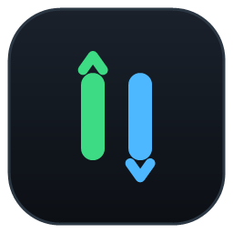
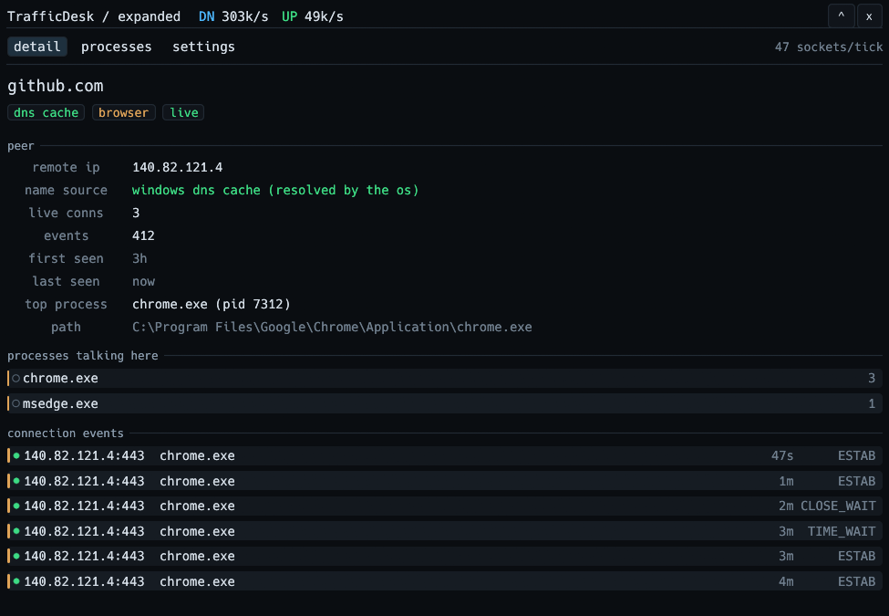
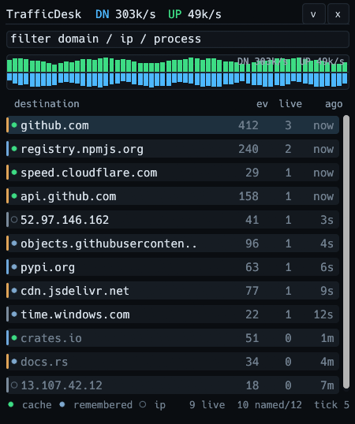

<p align="center">
  
</p>

<h1 align="center">TrafficDesk</h1>

<p align="center">
  Floating always-on-top Windows network monitor: live TCP peers, hostnames from the DNS
  cache, 14 days of history in SQLite. No driver, no admin rights, no packet capture.
</p>

<p align="center">
  <a href="https://github.com/Krow-zy/TrafficDesk/actions/workflows/ci.yml"></a>
  <a href="https://github.com/Krow-zy/TrafficDesk/releases"></a>
  <a href="LICENSE"></a>
  
</p>

TrafficDesk answers one question: what is this machine talking to, right now? Each row is
one live TCP peer: the remote endpoint, the process behind it, and a hostname when Windows
knows one. The numbers come from kernel tables and the DNS client cache, and every peer is
remembered in SQLite so one that was busy an hour ago is still labelled.



## Contents

- [Modes](#modes)
- [How it works](#how-it-works)
- [Privacy](#privacy)
- [Data and config](#data-and-config)
- [Run it](#run-it)
- [Build from source](#build-from-source)
- [Limits, stated plainly](#limits-stated-plainly)
- [License](#license)

## Modes

| | Mode | Size | What it is for |
|---|---|---|---|
| <kbd>Ctrl</kbd>+<kbd>Alt</kbd>+<kbd>1</kbd> | MiniBar | 560 x 28 | Rate readout that sits next to the clock |
| <kbd>Ctrl</kbd>+<kbd>Alt</kbd>+<kbd>2</kbd> | Panel | 360 x 430 | Destination list, filter, live rates |
| <kbd>Ctrl</kbd>+<kbd>Alt</kbd>+<kbd>3</kbd> | Expanded | 780 x 540 | Panel plus details, processes and settings |

| MiniBar | Panel |
|---|---|
|  |  |

<kbd>Ctrl</kbd>+<kbd>Alt</kbd>+<kbd>H</kbd> hides and restores the window. The window is
hidden by minimizing it, so it stays off the taskbar. The tray menu has the same modes
plus **Quit**. Drag anywhere in the title strip to move the window.

The header always shows the two numbers that matter: current download and upload rate
for the interface, and how many sockets were counted in the last tick.

## How it works

| What you see | Where it comes from |
|---|---|
| Destination list, live/idle sockets, events | `GetExtendedTcpTable` census once per tick, IPv4 and IPv6, TCP only |
| Rates | `GetIfTable2` interface counters, differenced per tick |
| Process, PID, image path | `QueryFullProcessImageNameW` with a toolhelp fallback, cached 20 s |
| Hostnames | `MSFT_DNSClientCache` (WMI) read every 20-60 s, plus names learned earlier |
| History, sparkline, per-destination timeline | SQLite in the data folder, pruned at 14 days by default |

A dot at the start of each row shows where the name came from, and the footer legend
spells it out: `cache` for a name Windows has in its resolver cache right now,
`remembered` for a name learned earlier from this machine's own traffic, and `ip` for a
peer that has no name at all. Bare IPs are normal for peers that never appeared in the
resolver cache.

## Privacy

TrafficDesk never sends anything anywhere. It has no analytics, no update check and no
network client of its own: it names peers from the local DNS cache and from its own
history file, and it deliberately does not perform reverse DNS lookups. Everything is
stored locally, in a folder you can delete at any time.

Set `TRAFFICDESK_DEMO=1` to replace captured data with the fixed sample rows from
`src/demo.rs`. That is how the screenshots above were taken, so no hostname, address or
process name of a real machine is in them.

## Data and config

Runtime files live in `%TEMP%\TrafficDesk` (or `TRAFFICDESK_DATA_DIR` when set):

| File | Contents |
|---|---|
| `config.toml` | Settings, see below |
| `trafficdesk.db` | Connection events, throughput samples, remembered names |
| `trafficdesk.log` | Rotating log, three 2 MB files |

Deleting the folder is safe and costs only history. Note that Windows and cleanup tools
may empty `%TEMP%` on their own, so treat the history as disposable.

`config.toml` is re-read while the app runs, so edits apply within a second:

| Key | Default | Meaning |
|---|---|---|
| `poll_interval_ms` | `1000` | Census interval, clamped to 500-5000 |
| `retention_days` | `14` | History kept, clamped to 1-365 |
| `ignore_processes` | `[]` | Substring match on process names to leave out |
| `mode` | `"panel"` | Start mode: `mini`, `panel` or `expanded` |

## Run it

Download the zip from the [releases page](https://github.com/Krow-zy/TrafficDesk/releases),
unpack it and run `trafficdesk.exe`. Windows 10 or 11 on x64, no installer, no admin
rights, single file of about 5.8 MB.

One instance runs at a time. Starting a second one shows a message pointing at the tray
icon of the running copy.

## Build from source

Rust with the MSVC toolchain, plus the Visual Studio build tools:

```
cargo build --release     # target\release\trafficdesk.exe
cargo test --release      # unit tests; two live-cache tests are ignored by design
```

The app icon and the version block in the executable are embedded by `build.rs`, which
calls `rc.exe` from the Windows SDK. Without the SDK the build still succeeds, only
without the icon. `tools/make-icon.ps1` regenerates `assets/icon.ico` and the PNGs from
GDI+ drawing code, and `tools/capture-ui.ps1` regenerates the screenshots in `docs/`
from demo mode.

### Releasing

CI checks every push. Tagging starts `.github/workflows/release.yml`, which tests,
builds and uploads the zip as a workflow artifact. Publishing the release is a manual
step on purpose, so the release is attributed to a person instead of to a bot:

```
git tag -a v0.1.0 -m "TrafficDesk 0.1.0" && git push origin v0.1.0
gh run watch <run-id> --exit-status
gh run download <run-id> -n TrafficDesk-windows-x64
gh release create v0.1.0 TrafficDesk-v0.1.0-windows-x64.zip --title v0.1.0 --generate-notes
```

## Limits, stated plainly

- Memory sits around 120 MB of working set. That is the floor for this stack (eframe,
  glow, a GPU context); a bare window with nothing in it measures higher than the app.
  Idle CPU is well under one percent of a core.
- Rates are per interface, not per destination: Windows does not expose per-socket byte
  counts without a driver. The list tells you which peers and processes are active, the
  header tells you how fast the link is going.
- TCP only. UDP traffic is not listed.
- Hostnames depend on the OS DNS cache being populated for the peer. Reverse lookups are
  intentionally not used, so some rows stay bare IPs, especially for long-lived
  connections whose cache entry has already expired.
- The app is a monitor, not a firewall: it reports connections, it does not block them.

## License

MIT, see [LICENSE](LICENSE).
